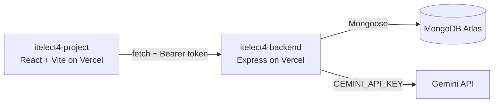

# itelect4-project

[](https://github.com/tobskie/itelect4-project/actions/workflows/ci.yml)

A TypeScript and React web application for a Peer Tutoring Booking Platform, built with Vite, Tailwind CSS, TanStack Query, and React Router.

- **Live Site:** https://itelect4-project-alpha.vercel.app/
- **Backend repo:** https://github.com/tobskie/itelect4-backend

## Architecture



## Local Development

```bash
# 1. Install dependencies
npm install

# 2. Configure environment (.env)
# Copy .env.example to .env and set VITE_API_URL

# 3. Start development server
npm run dev

# 4. Run tests
npm test

# 5. Build and typecheck
npm run build

# 6. Lint
npm run lint
```
